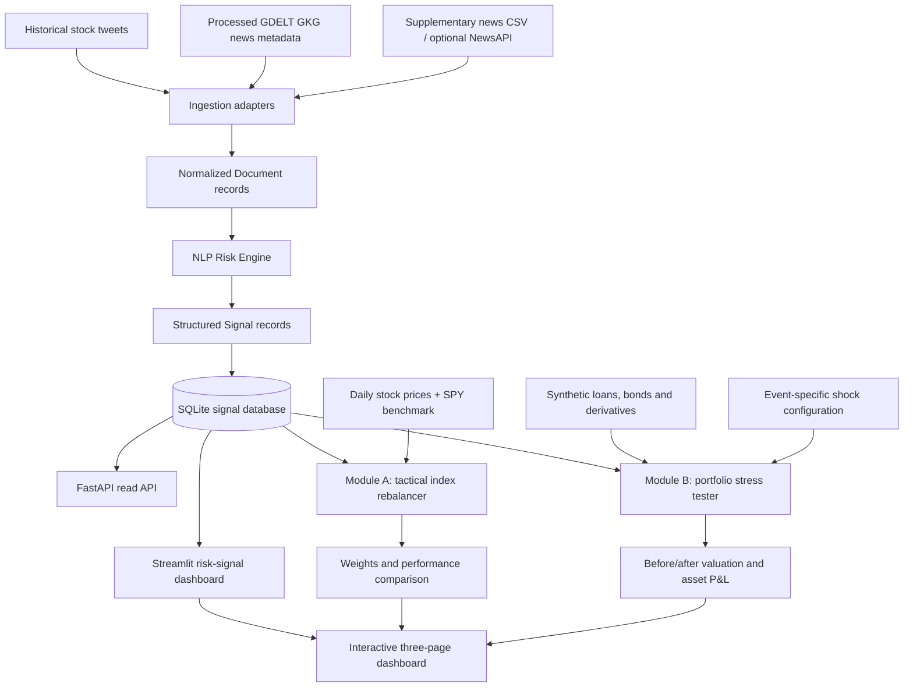

# Code to Connect — Financial Risk Intelligence
## S&P Global & CRISIL Campus Hackathon 2026

**Candidate Name:** Aniket Sonawane  
**College Email ID:** `img_2022010@iiitm.ac.in`  
**College / Campus:** ABV-IIITM Gwalior  
**Demo Video Link:** `[add the public/unlisted YouTube URL after recording]`  
**Slide Deck Link (if hosted externally):** Not required when `docs/presentation.pptx` is included in this repository.  
**Repository:** `https://github.com/Aniket-SS/abv-iiitm-gwalior-aniket-sonawane-hackathon`

## 1. Project Overview / Problem Statement & Approach

Financial news and social-media posts contain fast-moving information that can affect companies and markets, but the text is unstructured and difficult for downstream applications to consume consistently. This project builds a modular NLP Risk Engine that converts timestamped text into structured financial risk signals. Each signal contains a ticker or market scope, sentiment score, event classification, impact score, confidence, source, timestamp, and a short rationale/snippet.

The pipeline normalizes data from historical stock-related tweets, processed GDELT GKG news metadata, an optional NewsAPI adapter, and a supplementary historical news CSV. The NLP engine performs text preprocessing, conservative entity/ticker linking, sentiment scoring, event classification, and heuristic impact scoring. Signals are persisted in SQLite and exposed through a FastAPI read API. A Streamlit dashboard presents the stored signals and connects the same signal store to two downstream applications: a sentiment-tilted mock-index backtest (Module A) and event-driven stress testing of a synthetic wholesale banking portfolio (Module B).

The implementation supports historical analysis and locally stored signals. It should not be described as a continuously streaming production system: live NewsAPI ingestion is optional and depends on a valid key and account-plan permissions; the current index rebalancer is a historical daily-close simulation. Outputs are illustrative and are not investment advice or a production banking risk model.

## 2. Architecture & Tech Stack

### Architecture



See [docs/architecture.md](docs/architecture.md) for component responsibilities, data contracts, and assumptions.

### Tech stack

- **Language:** Python (Python 3.11 recommended).
- **NLP / data:** pandas, NumPy, Pydantic, spaCy (optional entity support), Hugging Face Transformers for FinBERT and zero-shot event classification when available.
- **API / persistence:** FastAPI, Uvicorn, SQLite.
- **Dashboard / visualization:** Streamlit, Plotly.
- **Configuration / testing:** YAML, pytest.
- **Market data:** daily historical close prices from the project's yfinance-based price-fetching workflow; SPY is used as a benchmark, not as one of the 16 investable stocks.

## 3. Dataset Used

The project uses public or locally supplied datasets for development/evaluation and a project-authored synthetic portfolio for Module B. Keep source data in the locations expected by the scripts, under `data/raw/`; generated JSONL, SQLite, price panels, and model artifacts belong under `data/processed/` unless a workflow specifies otherwise.

| Data / source | Role in the project | Important assumptions / limits |
|---|---|---|
| Historical stock tweets (`stock_tweets.csv`) | Timestamped social-text replay for configured company tickers | Historical replay covers 2021-09-30 to 2022-09-29. Source licensing/redistribution terms must be checked before publishing raw files. |
| Processed GDELT bulk GKG files | News/event metadata and headline-based documents | This project uses downloaded bulk GKG processing; the rate-limited GDELT DOC API adapter was removed. GKG records are metadata/headline-based, not full article bodies. |
| NewsAPI | Optional recent news headline/description adapter | Requires `NEWSAPI_API_KEY` in `.env` and an account plan that permits the intended use. It is not required for the local demo. |
| `news_vs_market_2020/news_sentiment_raw.csv` | Supplementary timestamped news/context | Kept separate from derived daily sentiment and market-feature tables; source sentiment values are metadata, not engine output. |
| SEntFiN and `all-data.csv` | Sentiment evaluation datasets | Evaluation-only; do not fabricate publication timestamps or merge these into the live ingestion stream. Check exact dataset terms before redistribution. |
| `market_events_2025` | Event taxonomy/rule-testing reference | Contains repeated/template-like records; not treated as verified live news. |
| `data/raw/prices/prices_daily.csv` | Historical prices for 16 stocks and SPY | Current dashboard screenshot showed 1,262 dates through 2026-10-09. Verify data-provider terms before redistributing the full price file. |
| `data/synthetic/wholesale_portfolio.csv` | Module B demo portfolio | Project-authored synthetic portfolio with 7 assets across loans, bonds, and derivatives; illustrative initial value shown in the dashboard is $86.25 million. |

**Data-handling note:** The database displayed by the dashboard is the project's structured signal output, not a substitute for documenting its source data. Do not commit `.env`, API keys, large raw datasets, full article text, or datasets with unverified redistribution rights. Include small project-authored synthetic data needed to reproduce the demo. The `data/` directory and the source/licensing register should clearly explain how to obtain any excluded inputs.

### Signal contract

The common signal record includes `signal_id`, `doc_id`, `timestamp` (UTC), `source`, `channel`, `ticker`, `scope`, `company`, `sentiment` (-1 to +1), `event_type`, `impact` (1 to 10), `confidence` (0 to 1), `rationale`, and `text_snippet`.

Company-linked signals use a real ticker and `scope="company"`. Unlinked news can be retained as `ticker="MARKET"` with `scope="market"`; the system does not invent a company mapping. Module A excludes market-scope signals. Module B can consume market-wide or company-specific signals.

## 4. Quickstart & Installation

**Runtime:** Python 3.11 recommended. The documented commands below use PowerShell on Windows; use the equivalent activation syntax on other operating systems.

### Install

```powershell
git clone [YOUR_PUBLIC_REPOSITORY_URL]
cd [YOUR_REPOSITORY_FOLDER]
py -3.11 -m venv .venv
.\.venv\Scripts\Activate.ps1
python -m pip install --upgrade pip
python -m pip install -r requirements.txt
python -m pytest -q
```

### Prepare the signal database

The dashboard expects `data/processed/signals.db`. The database is generated by importing structured signals; do not assume it exists in a fresh clone.

1. Place permitted source datasets in their expected `data/raw/` paths. Keep restricted or license-uncertain files local.
2. Run the adapters for sources that are available:

```powershell
python -m scripts.ingest_tweets
python -m scripts.process_gdelt
python -m scripts.ingest_gdelt_processed
python -m scripts.ingest_news_vs_market
```

3. Merge the JSONL files that were successfully generated. Include only files that exist:

```powershell
python -m scripts.merge_ingestion data/processed/ingestion/stock_tweets.jsonl data/processed/ingestion/news_vs_market.jsonl data/processed/ingestion/gdelt_documents.jsonl
```

4. Run the NLP engine and import its output into SQLite:

```powershell
python -m scripts.run_engine data/processed/ingestion/documents.jsonl --mode auto --output data/processed/phase3_all_signals.jsonl
python -m scripts.import_signals data/processed/phase3_all_signals.jsonl
```

The exact merge inputs depend on which adapters completed. Use `python -m scripts.merge_ingestion --help`, `python -m scripts.run_engine --help`, and `python -m scripts.import_signals --help` if CLI arguments differ in the checked-out revision. `--mode auto` attempts configured pretrained models and may download model files; for a deterministic smoke test without model downloads, use `--mode rules --no-spacy` where supported. Install the spaCy model only if you want its optional NER support:

```powershell
python -m spacy download en_core_web_sm
```

**Optional NewsAPI:** add `NEWSAPI_API_KEY=your_key_here` to `.env` and run `python -m scripts.ingest_newsapi --days-back 7 --page-size 100`. Never commit `.env`.

### Prepare prices and launch

Ensure `data/raw/prices/prices_daily.csv` exists and contains the 16 configured tickers plus SPY. If you need to fetch or refresh it, inspect the available options with `python -m scripts.fetch_prices --help`.

```powershell
python -m scripts.run_rebalancer
python -m scripts.run_stress_test --threshold 7
python -m streamlit run src/dashboard/app.py
```

Open the local URL printed by Streamlit. The dashboard has three pages: the risk-signal overview, Index Rebalancer, and Stress Tester. The separate API can be started with:

```powershell
python -m uvicorn src.api.app:app --reload
```

Then open `http://127.0.0.1:8000/docs`.

## 5. Key Results & Domain Impact

### Current dashboard observations

The dashboard screenshot supplied for the current build showed:

- **Risk-signal database:** 109,262 stored signals.
- **Module A universe:** 16 investable stocks, with SPY benchmark-only; 1,262 price dates.
- **Module A cumulative return shown:** sentiment-tilted strategy 108.68%, static equal-weight portfolio 109.60%, SPY buy-and-hold 93.98%. These are the values shown in the captured dashboard and should be refreshed after a clean final backtest. The sentiment strategy did not outperform static equal weight in that run.
- **Module B example:** synthetic portfolio value $86.25M before the selected shock and approximately $76.09M after it, a loss of approximately $10.16M. The exact result depends on the selected signal and scenario.
- **Impact calibration diagnostic:** the original impact score had a Spearman correlation of approximately -0.094 with absolute abnormal return in the full event-study diagnostic documented in `docs/notes/impact_calibration.md`. A separate earlier purged holdout experiment reported an improved association for the learned model; do not mix these results. Treat all calibration figures as exploratory until refreshed and validated using a consistent time-based protocol.

### Why it matters

The prototype demonstrates a reusable signal contract between NLP and financial decision tools. The same stored signals can support historical sentiment-aware allocation and event-specific portfolio repricing. The dashboard exposes assumptions and outcomes so reviewers can inspect the inputs and consequences rather than relying on a single opaque score.

### Limitations

- The index rebalancer is a historical daily-close backtest, not an intraday execution system. It uses lagged signals, a 7-calendar-day lookback, a 48-hour half-life, a default 0.5 minimum confidence, 15% single-stock cap, and 10% maximum one-way turnover per rebalance. Transaction costs are not included.
- Sentiment and event classification can use pretrained models in `auto` mode, with deterministic fallback paths when model dependencies or downloads are unavailable. A fallback result is not equivalent to transformer inference.
- The impact score begins as an explainable heuristic; the learned calibration layer is experimental and does not predict return direction or guarantee performance.
- Module B uses a synthetic portfolio and deterministic, simplified sensitivities. It is a demonstration, not a production banking risk model.
- NewsAPI access, model downloads, dataset licensing, source coverage, and public-hosting persistence must be verified for the final deployment.

## References and project notes

- [Architecture](docs/architecture.md)
- [Demo walkthrough](docs/notes/demo_script.md)
- [Dataset and source decisions](docs/notes/data_decisions.md)
- [Dataset licensing register](docs/notes/data_licensing_phase1.md)
- [Phase 2 ingestion notes](docs/notes/README_PHASE2.md)
- [Phase 3 risk-engine notes](docs/notes/README_PHASE3.md)
- [Phase 4 API notes](docs/notes/phase4_api.md)
- [Phase 5 impact calibration](docs/notes/phase5_calibration.md)
- [Phase 6–9 quickstart](docs/notes/phase6-9_quickstart.md)

## Submission links

- **Public repository:** `[add URL]`
- **Unlisted YouTube demo (up to 10 minutes):** `[add URL after recording and testing in incognito]`
- **Presentation deck:** [`docs/presentation.pptx`](docs/presentation.pptx)

Before submission, confirm the repository is public, the demo plays in an incognito window, the deck is present, `python -m pytest -q` passes in a clean environment, and all excluded data dependencies are documented.
