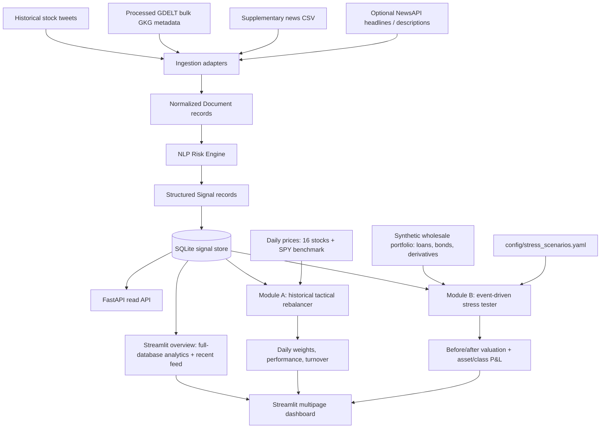

# Code to Connect — System Architecture

## End-to-end data flow

## Components and responsibilities

### 1. Ingestion

Adapters normalize heterogeneous text inputs to the shared `Document` contract (`id`, `source`, `channel`, UTC `timestamp`, `text`, optional title/URL, and source metadata). Current adapters cover historical stock tweets, processed GDELT bulk GKG headline/metadata records, the supplementary `news_vs_market_2020/news_sentiment_raw.csv`, and optional NewsAPI headlines/descriptions. The GDELT DOC API adapter was removed after rate limiting; the current GDELT workflow uses downloaded bulk GKG files. Price panels and derived feature tables are market/analysis inputs, not article documents.

### 2. NLP Risk Engine

The engine preprocesses text, conservatively links company/ticker entities, scores sentiment, classifies event type, estimates impact, and emits validated `Signal` records. The signal contract includes:

- `ticker` and `scope`: company-linked records use a real ticker and `scope="company"`; unlinked news may use `ticker="MARKET"` and `scope="market"`.
- `sentiment`: numeric value in `[-1, 1]`.
- `event_type`: configured taxonomy class (including `geopolitical`, `macroeconomic`, `credit_event`, `merger_acquisition`, `product_launch`, `earnings`, `regulatory_legal`, `leadership_change`, `operational_disruption`, and `other`).
- `impact`: heuristic severity score in `[1, 10]`.
- `confidence`: model/rule confidence in `[0, 1]`; it is not a calibrated probability of a future price move.
- `timestamp`, `source`, `channel`, `rationale`, and a short `text_snippet`.

FinBERT sentiment and zero-shot event classification are attempted in `auto` mode when configured dependencies/models are available. Deterministic lexicon/taxonomy fallbacks support local smoke tests. The heuristic impact score is not itself a predicted portfolio loss.

### 3. Signal store and API

Validated signals are imported into `data/processed/signals.db` through the SQLite store. The store supports idempotent signal import, filtering and time-decayed aggregation. FastAPI exposes `/health`, `/signals`, `/signals/{signal_id}`, `/signals/aggregate`, and an experimental `/signals/{signal_id}/impact-calibration` endpoint when the trained artifact is available.

The Streamlit dashboard reads the same stored database directly for the local demo. The overview distinguishes full-database analytics from a limited recent-signals table: limiting visible rows is a UI choice, not a filter on aggregate counts. Module B's qualifying-event query applies impact, recency, scope, and optional event-type filters to the stored signal table.

### 4. Module A — Tactical Index Rebalancer

- Universe: 16 configured stocks; SPY is benchmark-only.
- Input: company-scope signals only; `ticker="MARKET"` records are excluded.
- Process: aggregate eligible signals by ticker using confidence-weighted exponential time decay; use signals available before each daily return period; tilt equal weights by sentiment; apply single-name caps and a maximum one-way turnover limit.
- Outputs: daily weights, strategy/equal-weight/SPY performance series, summary statistics, and dashboard charts.
- Default assumptions: 7-calendar-day lookback, 48-hour half-life, minimum confidence 0.5, 15% maximum stock weight, 10% one-way turnover cap. Transaction costs are not included.

This is a historical daily-close simulation, not a live trading or intraday execution service. The strategy must be compared honestly with the static equal-weight baseline; the captured dashboard run showed 108.68% cumulative return for the strategy versus 109.60% for equal weight and 93.98% for SPY over the displayed sample. Refresh these metrics after the final clean run before citing them in a submission.

### 5. Module B — Strategic Portfolio Stress Tester

- Input event: actual stored NLP `Signal` with event classification and impact score; filters are applied against the full signal database, while the UI limits how many matching choices it displays.
- Trigger: the impact threshold defaults to 7.0/10; the engine triggers only when `impact >= threshold`. If the evaluator requirement is interpreted strictly as `> 7`, select threshold `7.01` or change the comparison and tests consistently.
- Portfolio: project-authored synthetic assets across loans, bonds and derivatives; the captured dashboard shows 7 assets and initial value $86.25M.
- Scenario: normalize event labels to the configured scenario key and apply the shock parameters in `config/stress_scenarios.yaml`.
- Outputs: before/after portfolio valuation, total P&L, asset-level and asset-class contributions, selected event and resolved scenario.

Shocks are deterministic illustrations using simplified duration/spread and derivative sensitivities. The synthetic portfolio is deliberately separate from the real signal data. The stress tester is not a production bank risk model.

## Dashboard

`python -m streamlit run src/dashboard/app.py` starts the multipage Streamlit UI:

1. **Risk Engine overview:** full-database sentiment and event analytics, plus a readable recent-signal table.
2. **Index Rebalancer:** controls, cumulative performance comparison, allocation heatmap, selected-date weights, per-ticker history and CSV downloads.
3. **Stress Tester:** qualifying actual stored signals, scenario selection, before/after valuation, and asset/class P&L charts.

The FastAPI service can also be run separately with `python -m uvicorn src.api.app:app --reload`.

## Data, security, and reproducibility

- Raw datasets remain unchanged under `data/raw/`; evaluation-only sources (SEntFiN and Financial PhraseBank-style `all-data.csv`) are not treated as live ingestion.
- The 2025 event dataset is used only as a taxonomy/rule-testing reference; its repeated/template-like records mean it should not be represented as verified real-world event coverage.
- Keep API keys in `.env`; never commit secrets, large raw data dumps, or datasets with unverified redistribution rights.
- Commit the small project-authored synthetic portfolio and reproducible configuration.
- Generated signals, SQLite database, price files, and learned model artifacts may be reproducible local artifacts; document how to regenerate them if they are not committed.
- Historical event-study/calibration results are exploratory, subject to timestamp granularity, overlapping/duplicated signals, price coverage and potential model/data overlap.

## Main implementation files

- `src/common/schemas.py` — `Document` and `Signal` contracts.
- `src/ingestion/` — normalized data adapters.
- `src/engine/` — preprocessing, entity linking, sentiment, event classification, impact and orchestration.
- `src/signals/store.py` — SQLite persistence, filtering and aggregation.
- `src/api/app.py` — FastAPI endpoints.
- `src/modules/rebalancer/engine.py` — Module A backtest.
- `src/modules/stress_test/engine.py` — Module B stress calculation.
- `src/dashboard/` — Streamlit pages and database access.
- `config/stress_scenarios.yaml` — event-specific shocks.
- `tests/` and `scripts/` — automated checks and CLI workflows.
