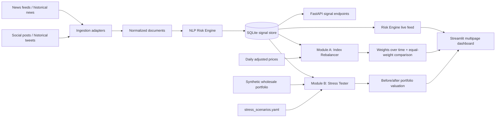

# Code to Connect — Architecture

## Module boundaries

- **Risk Engine:** normalizes news/social documents and emits one structured signal per linked ticker or market scope.
- **Signal store/API:** SQLite persistence and query endpoints. The dashboard reads the same local database so one Streamlit command is enough for the visual demo; the FastAPI remains available separately.
- **Module A:** historical, daily-close backtest. It uses only signals timestamped before each rebalance date, caps single-name weights, limits one-way turnover, and compares with a static equal-weight portfolio. Transaction costs are not included.
- **Module B:** synthetic loans, bonds, and derivatives repriced using deterministic shocks keyed by event type. High-impact threshold defaults to 7/10.
- **Dashboard:** home live feed, Index Rebalancer, and Stress Tester pages.

All portfolio values and shocks are illustrative. The stress module is not a production bank risk model; the backtest is not investment advice.
